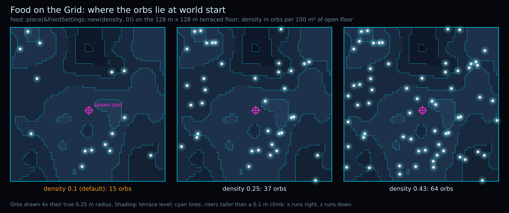
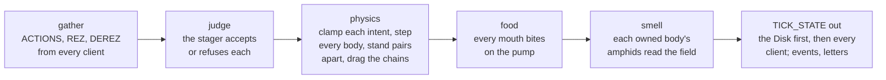
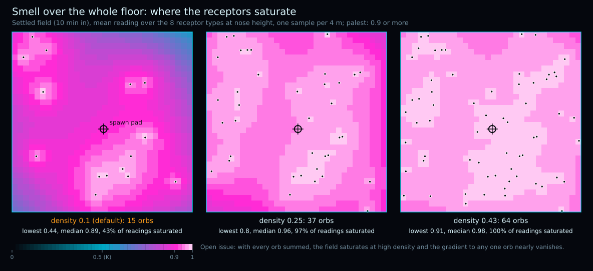

# master-control

The Master Control Program: the world server of the Grid.

**Master Control is the program that decides what is true in the Grid: 32 times a second it moves every
creature, feeds the ones that find food, and tells everyone connected what happened.**



## Start Here

```text
git submodule update --init    # the wire, external/link
cargo build
cargo test                     # unit tests, and whole worlds stood up on loopback
cargo run --release            # Greetings, Programs! Master Control listening on port 30702.
```

- **First contribution?** Pick a [good first issue](https://github.com/ai-quokka-wannabe/master-control/issues?q=is%3Aopen+label%3A%22good+first+issue%22)
  and read [CONTRIBUTING.md](CONTRIBUTING.md) - everyone who helps is [credited](#contributors).
- **Starting from a bare machine?** [docs/DEV_ENV_SETUP.md](docs/DEV_ENV_SETUP.md) builds, tests and runs the world on
  Windows or Linux exactly as CI does.

## One Tick



The loop gathers and judges on every turn; a tick steps whenever the wall clock owes one
(`Heartbeat::run` and `step_one_tick` in [src/heartbeat.rs](src/heartbeat.rs), `Roster::step` in
[src/roster.rs](src/roster.rs)). Food and smell go body by body in roster order, so two mouths in one orb
are settled the same way on every replay.

## What Master Control Is

One authoritative, deviceless process that owns what is true — the tick, the roster-of-record,
the validation of every Program's staged actions, the broadcast every client perceives through,
and the logs that let the world replay. TronGrid Lite instances connect to it today as creature
hosts and spectators, and on [the long arc](docs/VISION.md) every User's own client joins them;
Programs never see it at all. The film's tyrant, redeemed by good engineering.

## The Four Repositories

master-control is one of four repositories in the
[ai-quokka-wannabe](https://github.com/ai-quokka-wannabe) organisation.
[tron-grid-lite](https://github.com/ai-quokka-wannabe/tron-grid-lite) is the Grid — the
renderer, the senses and today's two client roles, and the flagship where this server's flesh
is grown before it moves here; [the link repository](https://github.com/ai-quokka-wannabe/link)
is the wire — the protocol library this server and every client today load as the same shared
binary; [rc-worm](https://github.com/ai-quokka-wannabe/rc-worm) is the first Program. Who owns
what, and why every delegation is the way it is, lives in the flagship's
[docs/TOPOLOGY.md](https://github.com/ai-quokka-wannabe/tron-grid-lite/blob/main/docs/TOPOLOGY.md)
— one table, kept in one place, pointed at from everywhere.

Where the four are headed together — over years, in baby steps — is one persistent Grid
where AI creatures live and human Users enter with avatars to meet them, its world state held
by this server and every client kept in sync. [docs/VISION.md](docs/VISION.md) tells that long
arc and this server's part in it; the organisation's
[landing page](https://github.com/ai-quokka-wannabe) carries the same arc.

## What Lives Here Today

A Rust world server, std-only, that listens on the Grid's port, welcomes spectators and creature
hosts through the very Link DLL every TronGrid Lite loads, and steps one simulated world at a
sacred 32 Hz:

- **The heartbeat** — the pacing accumulator with its clamp and its loud lag counter, the
  acceptance window with idempotent dedupe, the silence rules, keepalive reaping, the minimal
  flood posture.
- **The roster of record** — a host's `REZ` embodies a creature (or adopts an orphan), `DEREZ`
  and `BYE` are a leave, a crash leaves the body on the neutral reflex for the next host; every
  body is seated by the spawn rule on a spot of its own, and a `REZ` the world will not honour
  is answered with a `REFUSED` letter naming why.
- **The validator, the only path in** — bounds refused by name, subnormals flushed or refused,
  a body's extent capped, every malformed frame hung up on at the wire.
- **The chain** — a creature may be a chain of up to eight segments, articulated: every
  segment, the head included, is a rigid body in three dimensions under gravity, joined to its
  neighbours at ball-joint pivots and solved with XPBD. A servo at every joint drives the yaw
  towards the Program's own joint target with no more than its declared torque; nothing drives
  the pitch, and roll is locked, a simplification written down. Every vertex of every segment's
  hull meets the floor and the risers for itself, the runners' friction - gliding along,
  ploughing across - turns the wave into propulsion, and every segment that slides scrapes, a
  scratch event of its own, so a worm can hear its own body. The `PROPRIOCEPTION` letter carries
  the joint angles, their torques and every segment's contacts. Only the head meets another
  body, hull against hull; the trailing segments do not yet touch one another or other bodies.
- **The world's own arithmetic** — every transcendental that reaches state (`src/trig.rs`:
  `sin`, `cos`, `atan2`) is the world's own, built from IEEE basic arithmetic, so a life
  recorded on one machine replays bit for bit on any other running the same build; the
  platform's libm is banned from the crate by `clippy.toml`.
- **The physics** — the flagship's body step ported here as the one implementation: convex-hull
  proxies from the `REZ` mesh, exact contacts against the terraced floor and its risers,
  hull-against-hull separation, Coulomb friction, and a scratch for every slide, felt by the
  owner in a `PROPRIOCEPTION` letter every tick.
- **The logs** — `--disk <path>` records the world in the wire's own bytes (rolling over to
  `<stem>.0002.disk` and on at `--disk-roll <MiB>`, each file whole), `--log <path>` records
  every intent judged and applied and a periodic state hash, and **Clu** (`master-control clu
  <log> [<disk>]`) re-simulates a log and names the first bit that lies.
- **Food and smell** — glowing orbs placed at world start by the RNG of record (`src/food.rs`), eaten a
  bite per pharynx pump, and an odour field written down in closed form rather than simulated
  (`src/odour.rs`) that each creature's two amphids read as a fraction of receptors bound. See
  [Food and Smell, Drawn](#food-and-smell-drawn) below.

[TODO.md](TODO.md) carries each etape's decisions and what is still owed.

## Running the World

```text
master-control [port] [--verbose] [--version] [--disk <path>] [--disk-roll <MiB>] [--log <path>]
  [--food-density <orbs per 100 m^2>] [--config <file>]
```

Then, from a tron-grid-lite build: `TronGridLite --window` to watch, or `TronGridLite --program
<name>` to host a creature — the constellation on one machine.

Ctrl+C stops the world on request: the tick in hand finishes, the log gets its `end` line, the
Disk closes with its `BYE`, and the exit is 0 — a life that ends this way is one Clu accepts
without a word. A second Ctrl+C ends the process at once, the old way. The flagship's
[RUNNING_THE_GRID.md](https://github.com/ai-quokka-wannabe/tron-grid-lite/blob/main/docs/RUNNING_THE_GRID.md)
stands the whole ecosystem up around it.

## Food and Smell, Drawn

Every figure here is drawn by the world's own code - `food::place`, `physics::floor` and the functions
of `odour.rs` - so a figure that changes is a world that changed. After touching food, smell or the
floor, regenerate them and commit what moved; the output is byte-identical from run to run:

```text
cargo run --example figures    # writes docs/figures/*.svg from examples/figures.rs
```

Alone, one orb's odour is a usable gradient: its settled reading is 0.96 a body length (4.48 m) away and
0.5, half-saturation, at the decay length (44.8 m). Once eaten, its trace lingers for a moment, then
fades over some ten seconds.


**A known open problem, shown honestly:** every orb smells at once and the readings add. At the default
density the floor never reads below 0.44 and 43% of all readings are already 0.9 or more; at 0.25 that
is 97%, and at the most the wire carries (0.43, 64 orbs) every reading on the floor is 0.91 or more - the
receptors saturate everywhere and the gradient towards any one orb all but vanishes.



## The Doctrine

- **Authoritative, always.** Master Control owns physics and truth; clients own perception.
  Every surveyed alternative is a named disaster in the blueprint.
- **Deviceless, forever.** The world is a hierarchy, some arithmetic and a tick loop. No GPU, no
  window, no swapchain — a server that runs headless in a cupboard.
- **dt is sacred; the wall clock is the degree of freedom.** An overrunning tick slips the
  schedule rather than the physics.
- **The world replays; the minds do not.** Dual state-and-input logs with a periodic state hash,
  so any run can be replayed from what was recorded.

## Building

Rust 1.99.1, pinned by `rust-toolchain.toml` and installed by [rustup](https://rustup.rs/) on
first use; no dependencies. `git submodule update --init` brings the wire
(`external/link`); `build.rs` builds its cdylib and puts it beside the executable, which is the
only place this server ever looks for it. `cargo test` runs the unit suite and the integration
suite that stands whole worlds up on loopback; `cargo fmt --check` and `cargo clippy
--all-targets -- -D warnings` are what CI gates on, both platforms.

## Contributors

Everyone who helps is credited here, for any kind of contribution: code, documentation, bug reports,
reviews, ideas, answers in Discussions. The list follows the
[All Contributors](https://allcontributors.org/en/reference/specification/) specification and is kept by hand;
[CONTRIBUTING.md](CONTRIBUTING.md#credit-and-copyright) says how to add yourself. Contributors keep the
copyright of what they write.

| Contributor | Contributions |
|-------------|---------------|
| [Matej Gomboc](https://github.com/MatejGomboc) | 💻 📖 🎨 🤔 🔬 🚇 🚧 ⚠️ |

The emoji follow the [All Contributors emoji key](https://allcontributors.org/en/reference/emoji-key/).

## Licence

Copyright © 2026 The AiQuokkaWannabe Authors <https://github.com/ai-quokka-wannabe/master-control>, listed under [Contributors](#contributors).

This program is free software: you can redistribute it and/or modify
it under the terms of the GNU General Public License as published by
the Free Software Foundation, either version 3 of the License, or
(at your option) any later version.

This program is distributed in the hope that it will be useful,
but WITHOUT ANY WARRANTY; without even the implied warranty of
MERCHANTABILITY or FITNESS FOR A PARTICULAR PURPOSE. See the
GNU General Public License for more details.

See the attached [LICENCE](LICENCE) file for more info.

---

End of line.
